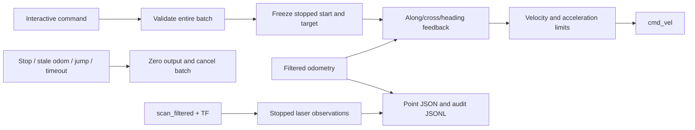

# Relative motion and teaching console (ROS 2 Humble)

This supervised tool executes relative translations/turns and records named odom
poses. It does not initialize against walls, navigate to recorded points, resume
old sessions, or provide obstacle avoidance. Laser data is observation-only.
Physical distance accuracy is not certified by synthetic-plant tests.

## Cloud update and launch

Stop teleop and other motion controllers first. Keep the existing robot drivers,
EKF, laser and TF running. The current stopped pose becomes P01 automatically.
Place/initialize the robot as desired before launching this console.

```bash
source /opt/ros/humble/setup.bash
cd ~/ros2_ws/src/distance_controller
git pull --ff-only
cd ~/ros2_ws
colcon build --packages-select distance_controller
source install/setup.bash
ros2 run distance_controller motion_console --laser-log-only
```

Default maximum translation speed is 0.04 m/s, angular speed 0.10 rad/s. Override
with `--speed` (.01-.08) and `--turn-speed` (.02-.20). Optional `--output FILE.json`
must be a new file. The default is `motion_points_<timestamp>.json` in the current
directory, with a matching `.jsonl` audit. Existing output is never overwritten.

## Commands

```text
move forward 0.10
move backward 0.05
move left 0.03
move right 0.03
move xy 0.10 0.03 --heading on --lateral on
move forward 0.10; move left 0.03
turn right 90
turn left 90
record P02
delta P01 P02
points
status
measure
stop
quit
```

Meters for translation; positive degrees for left/right turns. `xy` accepts signed
forward/left coordinates. Translation length is bounded to 2 m per command; turns
are bounded to 360 degrees. Commands are parsed as data, never evaluated by a shell.
A whole semicolon batch is syntax-validated before its first command executes.
Each motion captures its own actual stopped start pose. Sequential moves therefore
include the preceding motion's actual endpoint error; they are not absolute route
waypoints. An error, stop or Ctrl+C aborts the remaining batch.

`stop` + Enter works during motion. Ctrl+C also stops; the prompt remains available.
`quit` + Enter and EOF stop and exit. SIGTERM stops and exits. While moving, other
newly typed commands are discarded, not scheduled. Use semicolons to submit a batch.
This is an interactive tool, not a pipe-based automatic route executor.

## Correction meaning

Both flags default to `on`, independently on every `move`:

- `--heading on`: hold this command's initial heading using angular feedback.
- `--lateral on`: correct displacement perpendicular to the requested line.
- `--heading off`: angular command is zero; desired translation is still converted
  from the frozen start axes into the current body axes.
- `--lateral off`: no cross-track correction; arrival only checks along-track
  distance (plus heading when enabled). Full endpoint x/y accuracy is not claimed.

For `move xy .10 .03`, the reference is a straight diagonal, not forward then left.
Cross-track correction is perpendicular to that diagonal, not simply body `vy`.
Turns command angular motion only, preserve the requested sign, and reject more
than 4 cm estimated center drift. Completion needs the enabled errors within
5 mm along/cross, 0.01 rad heading, plus stopped measured speed for 0.5 seconds.
These are **odom acceptance tolerances**, not real-world accuracy guarantees.

## Point data

`record NAME` captures a stopped pose and laser observation, rechecks the pose,
and atomically saves the JSON. Duplicate names are rejected; use a new label for
revisions or pre/post-turn poses. P01 is created automatically and cannot be replaced.

Every point contains raw odom x/y/yaw, timestamp, session UUID (at file level),
P01-relative forward/left/yaw and a laser observation. `delta A B` returns:

- `start_body`: forward/left displacement relative to A's heading, straight-line
  distance and shortest signed yaw difference in degrees;
- `p01_axes`: displacement in the session origin's axes;
- `odom_axes`: raw odom coordinate subtraction.

A delta is net displacement, not traveled path length or proof of free passage.
No cross-session import/motion is supported: a new odom epoch needs a new file.

`measure` prints sensor-origin ranges and separately labelled fitted body gaps.
Body gaps reuse the existing **provisional** chassis/wheel model; they are not a
certified hardware outline. Missing scans/TF or failed wall fits are labelled
unavailable, never interpreted as open space. Laser observations run while stopped,
including after each completed motion and during point recording; they do not stop
motion even for a nearby obstacle. No continuous laser avoidance is implemented.

## Data/control flow



The runtime reuses the existing odom continuity/freshness checks, detects competing
velocity publishers and uses the same local lock as other supervised tools. This
is not a hardware emergency stop and cannot prevent an independent publisher from
commanding the base. The base watchdog must remain enabled. Plausible accumulated
odom drift and small undetected resets cannot be excluded by jump checks.

## Verification

```bash
python3 -m unittest discover -s test -p 'test_*.py'
# Dedicated localhost domain only; synthetic odometry, no real robot:
ROS_LOCALHOST_ONLY=1 ROS_DOMAIN_ID=197 python3 test/verify_motion_console.py
```

See `motion_model.py` for frame conversion and correction logic and
`motion_console.py` for ownership, cancellation, observation and persistence.
The integration fixture verifies the installed ROS executable; it is not a maze
simulation and does not validate wheel slip, braking distance or obstacle clearance.
## Optional right-wall start preparation

Before starting the console, prepare the stopped origin with:

```bash
ros2 run distance_controller odom_trial \
  --start prepare --alignment-wall right \
  --positioning-wall right --right-target-distance 0.26 \
  --laser-log-only
```

At the `odom>` prompt, enter `quit`, then start `motion_console`. Do not enter
`next` or `run` when only preparing the origin.

`alignment-wall` selects heading alignment. `positioning-wall right` additionally
uses the right wall for lateral positioning instead of left/right centering.
The 0.26 m target is measured from the base_link origin, not the body edge or
laser origin. Rear positioning retains its 0.28 m target. Missing left returns
are observed but do not invalidate this preparation mode. Missing right/rear
returns still stop preparation, as do stale data and existing travel limits.
The default `positioning-wall center` preserves the two-side centering behavior.

Local synthetic verification (no hardware):
```bash
WALL_CASE=odom_trial_right_only python3 test/verify_wall_session.py
WALL_CASE=odom_trial_right_only PREP_FAIL=right python3 test/verify_wall_session.py
WALL_CASE=odom_trial_right_only PREP_FAIL=rear python3 test/verify_wall_session.py
WALL_CASE=odom_trial_prepare python3 test/verify_wall_session.py
```
These checks verify required-wall selection, correction direction, stopped
handoff and fault stops; hardware placement accuracy remains unverified.
