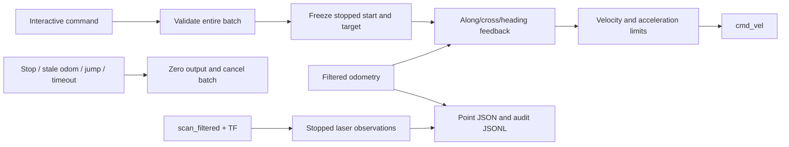

# Relative motion and teaching console (ROS 2 Humble)

This supervised tool executes relative translations/turns and records named odom
poses. It does not initialize against walls, navigate to recorded points, resume
old sessions, or provide obstacle avoidance. Laser data is observation-only.
Physical distance accuracy is not certified by synthetic-plant tests.

## Cloud update and launch

Stop teleop and other motion controllers first. Keep the existing robot drivers,
EKF, laser and TF running. The current stopped pose becomes P01 automatically.
Place/initialize the robot as desired before launching this console.

```bash
source /opt/ros/humble/setup.bash
cd ~/ros2_ws/src/distance_controller
git pull --ff-only
cd ~/ros2_ws
colcon build --packages-select distance_controller
source install/setup.bash
ros2 run distance_controller motion_console --laser-log-only
```

Default maximum translation speed is 0.04 m/s, angular speed 0.10 rad/s. Override
with `--speed` (.01-.08) and `--turn-speed` (.02-.20). Optional `--output FILE.json`
must be a new file. The default is `motion_points_<timestamp>.json` in the current
directory, with a matching `.jsonl` audit. Existing output is never overwritten.

## Commands

```text
move forward 0.10
move backward 0.05
move left 0.03
move right 0.03
move xy 0.10 0.03 --heading on --lateral on
move forward 0.10; move left 0.03
turn right 90
turn left 90
record P02
delta P01 P02
points
status
measure
stop
quit
```

Meters for translation; positive degrees for left/right turns. `xy` accepts signed
forward/left coordinates. Translation length is bounded to 2 m per command; turns
are bounded to 360 degrees. Commands are parsed as data, never evaluated by a shell.
A whole semicolon batch is syntax-validated before its first command executes.
Each motion captures its own actual stopped start pose. Sequential moves therefore
include the preceding motion's actual endpoint error; they are not absolute route
waypoints. An error, stop or Ctrl+C aborts the remaining batch.

`stop` + Enter works during motion. Ctrl+C also stops; the prompt remains available.
`quit` + Enter and EOF stop and exit. SIGTERM stops and exits. While moving, other
newly typed commands are discarded, not scheduled. Use semicolons to submit a batch.
This is an interactive tool, not a pipe-based automatic route executor.

## Correction meaning

Both flags default to `on`, independently on every `move`:

- `--heading on`: hold this command's initial heading using angular feedback.
- `--lateral on`: correct displacement perpendicular to the requested line.
- `--heading off`: angular command is zero; desired translation is still converted
  from the frozen start axes into the current body axes.
- `--lateral off`: no cross-track correction; arrival only checks along-track
  distance (plus heading when enabled). Full endpoint x/y accuracy is not claimed.

For `move xy .10 .03`, the reference is a straight diagonal, not forward then left.
Cross-track correction is perpendicular to that diagonal, not simply body `vy`.
Turns command angular motion only, preserve the requested sign, and reject more
than 4 cm estimated center drift. Completion needs the enabled errors within
5 mm along/cross, 0.01 rad heading, plus stopped measured speed for 0.5 seconds.
These are **odom acceptance tolerances**, not real-world accuracy guarantees.

## Point data

`record NAME` captures a stopped pose and laser observation, rechecks the pose,
and atomically saves the JSON. Duplicate names are rejected; use a new label for
revisions or pre/post-turn poses. P01 is created automatically and cannot be replaced.

Every point contains raw odom x/y/yaw, timestamp, session UUID (at file level),
P01-relative forward/left/yaw and a laser observation. `delta A B` returns:

- `start_body`: forward/left displacement relative to A's heading, straight-line
  distance and shortest signed yaw difference in degrees;
- `p01_axes`: displacement in the session origin's axes;
- `odom_axes`: raw odom coordinate subtraction.

A delta is net displacement, not traveled path length or proof of free passage.
No cross-session import/motion is supported: a new odom epoch needs a new file.

`measure` prints sensor-origin ranges and separately labelled fitted body gaps.
Body gaps reuse the existing **provisional** chassis/wheel model; they are not a
certified hardware outline. Missing scans/TF or failed wall fits are labelled
unavailable, never interpreted as open space. Laser observations run while stopped,
including after each completed motion and during point recording; they do not stop
motion even for a nearby obstacle. No continuous laser avoidance is implemented.

## Data/control flow



The runtime reuses the existing odom continuity/freshness checks, detects competing
velocity publishers and uses the same local lock as other supervised tools. This
is not a hardware emergency stop and cannot prevent an independent publisher from
commanding the base. The base watchdog must remain enabled. Plausible accumulated
odom drift and small undetected resets cannot be excluded by jump checks.

## Verification

```bash
python3 -m unittest discover -s test -p 'test_*.py'
# Dedicated localhost domain only; synthetic odometry, no real robot:
ROS_LOCALHOST_ONLY=1 ROS_DOMAIN_ID=197 python3 test/verify_motion_console.py
```

See `motion_model.py` for frame conversion and correction logic and
`motion_console.py` for ownership, cancellation, observation and persistence.
The integration fixture verifies the installed ROS executable; it is not a maze
simulation and does not validate wheel slip, braking distance or obstacle clearance.
## Optional right-wall start preparation

Before starting the console, prepare the stopped origin with:

```bash
ros2 run distance_controller odom_trial \
  --start prepare --alignment-wall right \
  --positioning-wall right --right-target-distance 0.26 \
  --laser-log-only
```

At the `odom>` prompt, enter `quit`, then start `motion_console`. Do not enter
`next` or `run` when only preparing the origin.

`alignment-wall` selects heading alignment. `positioning-wall right` additionally
uses the right wall for lateral positioning instead of left/right centering.
The 0.26 m target is measured from the base_link origin, not the body edge or
laser origin. Rear positioning retains its 0.28 m target. Missing left returns
are observed but do not invalidate this preparation mode. Missing right/rear
returns still stop preparation, as do stale data and existing travel limits.
The default `positioning-wall center` preserves the two-side centering behavior.

Local synthetic verification (no hardware):
```bash
WALL_CASE=odom_trial_right_only python3 test/verify_wall_session.py
WALL_CASE=odom_trial_right_only PREP_FAIL=right python3 test/verify_wall_session.py
WALL_CASE=odom_trial_right_only PREP_FAIL=rear python3 test/verify_wall_session.py
WALL_CASE=odom_trial_prepare python3 test/verify_wall_session.py
```
These checks verify required-wall selection, correction direction, stopped
handoff and fault stops; hardware placement accuracy remains unverified.

## Precise P01 preparation (experimental measurement acceptance)

Add `--precise-start` to the right-wall preparation command:

```bash
ros2 run distance_controller odom_trial \
  --start prepare --alignment-wall right \
  --positioning-wall right --right-target-distance 0.26 \
  --precise-start --laser-log-only
```

This opts into 5 mm distance and 0.5 degree heading tolerances (or tighter C++
parameter overrides), caps positioning at 0.02 m/s and at 0.008 m/s within 2 cm
of both distance targets. It does not alter the default route or legacy mode.

Precise preparation defaults to a rear sampling half-angle of 10 degrees; legacy
preparation retains 5 degrees. An explicit C++ ROS parameter
`rear_window_half_angle` (radians) overrides either default. The startup log prints
the effective window. This changes the estimator, not the acceptance tolerances.
The stationary P01 bag showed a rear median range of 14.95 mm at 5 degrees and
5.08 mm at 10 degrees, with a 3.59 mm median shift. The sensor transform was
confirmed as translation (0.020, 0, 0.173) m and yaw pi. Reduced variation is
offline evidence only; physical accuracy and repeated initialization remain
to be validated on the robot.

On entering tolerance, command zero; require measured translation below 0.003 m/s,
rotation below 0.01 rad/s, and a 0.5 s hold. Then collect 15 distinct post-hold
scans. More than 3 mm odom displacement or 0.005 rad heading drift during this
window discards the evidence and starts a new hold. Existing stale-data, required
right/rear validity, preparation travel and overall time limits remain active.

Each frame contains base-origin right/rear distances and a fresh right-wall angle.
Joint samples more than 2 cm or 2 degrees from the batch medians are discarded;
invalid heading fits count against consensus. Require at least 12/15 retained,
right/rear retained ranges each at most 1 cm, and angle range at most 2 degrees.
Only then compare the retained medians with 0.26/0.28 m and zero wall angle.
Stability and target accuracy are separate checks. Sensor bias or a consistently
wrong wall cannot be detected by these statistics alone.

An unstable batch keeps zero velocity while another batch is collected. Each
verification attempt has a 5 s budget; at most three stable-but-off-target
refinements are allowed. Heading refinement reacquires the wall direction.
`START_VERIFY_TIMEOUT` or `START_REFINEMENT_LIMIT` fails without recording P01;
no tolerance is widened automatically. Valid completion prints `START_VERIFIED`
and the usual `preparation complete` handoff. `START_VERIFY` reports medians,
spreads and retained counts; the legacy `Centered A` distances are the latest
single scan and can differ from the accepted median.

This is initialization-only. `motion_console record` has not yet been converted
to this batch policy. The tool still captures its own current stopped P01 after
handoff. Save the preparation terminal output as the multi-frame evidence.
These are measurement acceptance targets, not a claim of 5 mm physical accuracy.

Synthetic checks additionally support `PRECISE_START=1`, `PRECISE_NOISE=spikes`
or `PRECISE_NOISE=unstable` with `WALL_CASE=odom_trial_right_only` in the existing
fixture. No real hardware is driven by these localhost-domain tests.

## Continuous P01 to P02 repeatability trial

After successful precise initialization, quit `odom_trial` and start a **new**
`motion_console --laser-log-only` session without moving or resetting odom in between.
Then enter these commands separately:

```text
path_plan
path P02
```

`path_plan` is read-only. `path P02` loads the installed
`config/task6_p01_p02_path.json`, transforms its relative coordinates using this
session's recorded P01, and follows one continuous path. It does not reuse old
absolute odom coordinates. Input evidence is the user's measured P01, P01_F10
(0.100728402, 0.000929167 m), and P02 (0.840238840, -0.002600029 m).
Each measured edge is subdivided into <=5 cm edges, preserving P01_F10 exactly:
19 points total, including start and end. The heading stays at this session's
P01 heading; the taught P02 yaw error of -1.467 degrees is deliberately excluded.

The tracker projects onto the polyline, advances monotonic arc progress, and aims
5 cm ahead. It never stops at intermediate points or returns to a passed one.
Tracking uses a fixed P01 reference, body-frame velocity conversion and existing
acceleration limits; endpoint approach slows proportionally. At P02 require
Euclidean position error <5 mm, heading error <0.01 rad, and stopped feedback for
1 s; a further stopped check precedes reporting success. This is an odom criterion.
After success, record actual P02 with the existing stopped laser snapshot and print
`P02 comparison`. The JSON/JSONL contain actual points, full interpolated path,
current origin and transformed target, progress, completion/failure and observations.

Start requires the current pose within 1 cm / 1 degree of this session's P01.
A second `path P02` after P02 is recorded is rejected. After partial movement or
failure there is no automatic path resume: return near physical P01 under operator
control, reinitialize, then start a new console session. Off-path distance >5 cm,
odom continuity/freshness faults, conflicting velocity publishers and timeouts stop
motion. `stop`, Ctrl+C, quit/EOF and SIGTERM retain existing cancellation behavior.
Laser remains observation-only; interpolation does not certify free space.

This first entry supports only a reviewed forward near-straight P01-P02 path
(each edge within 10 degrees of P01 forward, total <=2 m). Do not edit it into
corners, reversals or a general maze route. Endpoint-only teaching cannot recover
an unrecorded avoidance maneuver. No automatic return to P01 is implemented.

For three independent trials, repeat initialization and create a new point file
each time; retain all console output and JSON/JSONL. Compare P02-relative endpoint,
heading, available wall observations and visual location. A small odom residual
alone does not establish physical repeatability or correct the earlier laser/odom
scale discrepancy. Ordinary `record` still uses a snapshot, not 15-frame acceptance.

```bash
# Local isolated synthetic test only, no robot domain:
ROS_LOCALHOST_ONLY=1 ROS_DOMAIN_ID=197 python3 test/verify_teaching_path.py
```

### Short scan gaps during precise preparation

With `--precise-start`, a scan gap longer than 0.5 s immediately commands zero
and prints `SCAN_RECOVERING`. Recovery has a fixed 2 s budget. Pre-stop, duplicate
and queued scans older than 0.2 s cannot establish recovery. Require at least
three distinct valid post-stop scans spanning 0.3 s, fresh odometry, and measured
speed below 0.003 m/s / 0.01 rad/s. Then `SCAN_RECOVERED` starts wall-heading
acquisition and positioning again, including the full 15-frame final verification.
No prior partial batch survives the gap. Existing stage, total-time and travel
limits remain in force. Persistent loss or old frames yield
`SCAN_RECOVERY_TIMEOUT`; required-wall invalidity outside recovery still fails.
Legacy preparation and path execution do not acquire this recovery behavior.

### P01-P02 speed selection

Start a new console at the initialized P01 using `--speed 0.06` for 6 cm/s.
The default remains 0.04 m/s. Path lookahead is max(0.05 m, speed / 1.5), so
the requested cruise speed is reachable; interpolation spacing stays at most
5 cm. The endpoint remains fixed, with proportional deceleration, position
error below 5 mm, heading error below 0.01 rad and a 1 s stopped hold.
These are odometry acceptance criteria, not guaranteed physical accuracy.

### Task5 gains for all motion_console commands
Path translation uses Kp=1.5, Ki=Kd=0. Heading uses Kp=1.8, Ki=0.03, Kd=0.35 with signed odom angular velocity damping and conditional integration bounded to +/-0.5. Path acceleration limits are 0.4 m/s^2 and 0.6 rad/s^2. Start at initialized P01 with `--speed 0.08` for 8 cm/s; the default remains 0.04. Angular speed remains the console `--turn-speed` cap (default 0.10 rad/s). Ordinary move/turn commands now share the Task5 translation gain and heading PID. Endpoint tolerance and stopped hold are unchanged. Gains match Task5, but the path tracker and vector speed limits are not the complete Task5 controller.

Explicit speed selection: use --speed 0.12 --turn-speed 0.6 for 12 cm/s translation and 0.6 rad/s angular cap. Accepted CLI ranges are .01-.12 m/s and .02-.60 rad/s; defaults remain .04/.10. These are caps, not constant commanded speeds. The angular cap also applies to path heading correction. No gain or endpoint changes accompany this limit expansion.

All console move, turn and path commands share translation Kp=1.5 and HeadingPid (1.8/.03/.35), with .4/.6 linear/angular acceleration limits. Each command starts with fresh integral state; settling clears integral. Heading-off resets/disables angular PID; lateral-off disables cross-track correction. Signed multi-revolution turns, fixed P01 path reference and existing acceptance/stop checks are preserved. Legacy action_session/initialization nodes are outside this console change.

### P01 to P03 and right turn
Use path_plan P03_turn for a read-only preview; path P03_turn runs P01-P02, stops and records P02, follows 20 interpolated P02-P03 points (at most 5 cm apart), stops and records P03, then turns to fixed P01 heading minus 90 degrees and records P03_after_turn. P03=(1.773003723416002,0.017908841631131794) in P01 axes. This is endpoint-based straight interpolation, not reconstruction of the manual trajectory. All targets use the same session P01; arrival error is not added to the second leg. Cancellation/failure aborts the remaining route; no automatic restart/resume from partial motion. A fresh initialized P01 session is required for another complete trial. Laser remains observation-only; this interpolated route has not yet been verified on hardware.

### P01 to P04 / P05 trial extensions
`path_plan P04` / `path_plan P05` preview without motion. `path P04` / `path P05`
always start a complete trial from a fresh initialized session P01: P02 stop,
P03 stop, right turn to P01 yaw minus 90 degrees, then P04 stop and optionally
P05 stop. These commands do not resume at the current waypoint.

Fixed P01 targets (meters): P04=(1.781439293373129,-0.5239300031759923),
P05=(1.3921754778962125,-0.5250984301851296). P03-P04 has 12 points;
P04-P05 has 9 points, including endpoints; spacing remains <=5cm. Both legs
hold P01 yaw minus 90 degrees. The P04-P05 leg is a right strafe, not a turn
followed by forward travel. Geometry remains in P01 axes; body commands rotate
using current odom heading. No measured turn drift is added to later targets.

Each leg requires its fixed start within 1cm / 1degree. Excess turn displacement
therefore stops before P04 instead of silently rebasing the route. Cancellation,
stale odom, failed recording or arrival prevents later legs; there is no partial
resume. Endpoints use 5mm planar / .01rad heading acceptance and the 1s stopped
hold. The existing speed selection .12m/s and .6rad/s and unified PID remain.

The original P05 sample had right body gap about .0282m; a route replay
measured only .0077-.0105m before the 1cm endpoint adjustment;
this is an experimental endpoint, not demonstrated collision margin. The new
endpoint chords are not a replay of the sampled manual trajectory. Hardware
repeatability and swept clearances remain unverified; laser is observation-only.
2026-10-11 trial adjustment: reduce P04-P05 right travel by 0.01 m (about
0.39926 to 0.38926 m along P01 x). P04, P05 y, heading, PID and speed limits
are unchanged. The new endpoint has not yet been verified on the robot.
